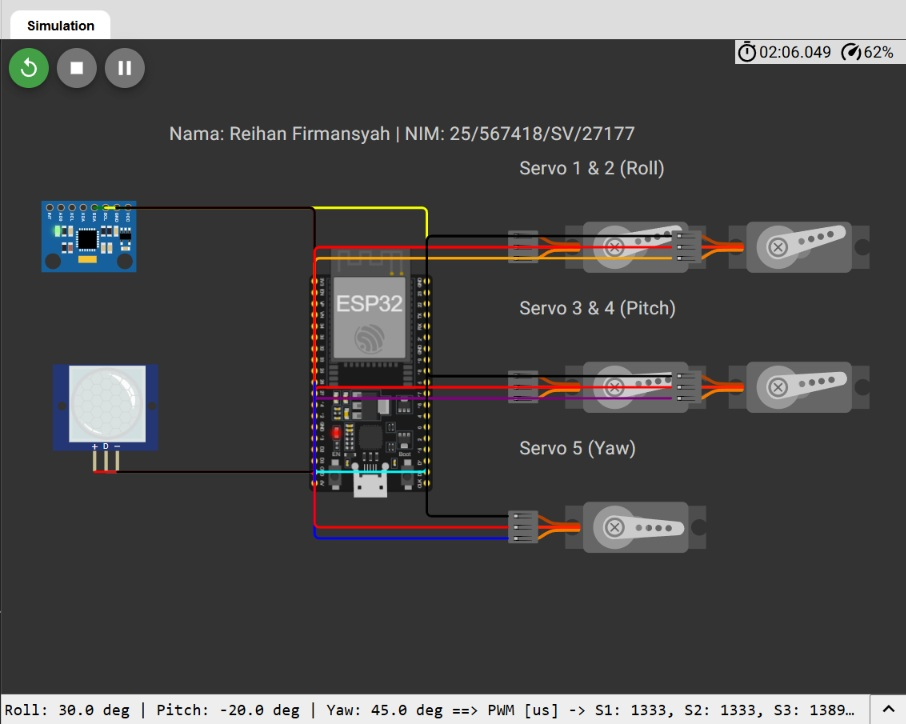
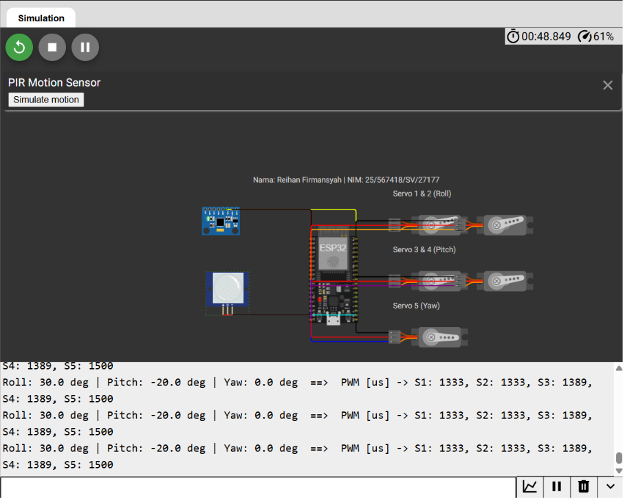
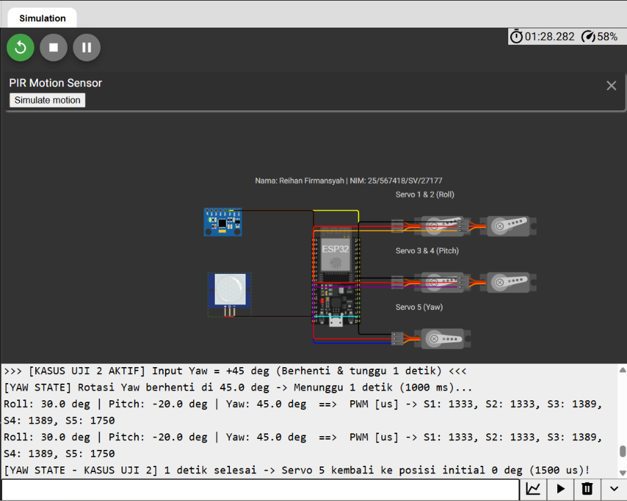

# Penugasan Day 3 Magang GMRT - Kontrol 5 Servo dengan IMU & Sensor PIR

## 1. Profile
* **Nama Lengkap:** Reihan Firmansyah
* **NIM:** 25/567418/SV/27177

## 2. Description
Proyek ini adalah simulasi kontrol 5 motor servo menggunakan **ESP32** berdasarkan pembacaan sudut orientasi **Roll, Pitch, dan Yaw** dari sensor IMU serta deteksi gerakan dari **sensor PIR**.
* **Mikrokontroler:** ESP32
* **Sensor:**
  * **IMU (MPU6050 sebagai pengganti BNO055 di Wokwi):** Membaca rotasi sumbu X (Roll), sumbu Y (Pitch), dan sumbu Z (Yaw).
  * **PIR Motion Sensor:** Mendeteksi adanya gerakan eksternal di sekitar robot.
* **Aktuator:** 5 buah motor servo (Servo 1 & 2 untuk Roll, Servo 3 & 4 untuk Pitch, dan Servo 5 untuk Yaw).
* **Protokol Komunikasi:**
  * **I2C:** Dipakai untuk komunikasi data antara ESP32 dan sensor IMU lewat pin `SDA (GPIO 21)` dan `SCL (GPIO 22)`.
  * **PWM (50 Hz / 20 ms):** Dipakai untuk mengatur sudut putar kelima servo dengan lebar pulsa `1000 us` (-90°), `1500 us` (0° / posisi awal), sampai `2000 us` (+90°).

## 3. Feature Table

| Fitur | Input (Sensor) | Output (Aktuator) | Perilaku |
| :--- | :--- | :--- | :--- |
| **Roll** | Rotasi Sumbu-X IMU (±90°) | Servo 1 (GPIO 13) & Servo 2 (GPIO 12) | Saat Roll bernilai positif, Servo 1 dan 2 bergerak berlawanan arah (ke arah negatif), begitu juga sebaliknya. |
| **Pitch** | Rotasi Sumbu-Y IMU (±90°) | Servo 3 (GPIO 14) & Servo 4 (GPIO 27) | Saat Pitch bernilai positif atau negatif, Servo 3 dan 4 bergerak searah dengan sudut Pitch. |
| **Yaw (State Machine)** | Rotasi Sumbu-Z IMU (±90°) | Servo 5 (GPIO 26) | Servo 5 bergerak mengikuti sudut Yaw. Ketika rotasi berhenti, sistem menunggu 1 detik menggunakan `millis()` tanpa memblokir pembacaan sensor lain, lalu Servo 5 balik otomatis ke posisi awal 0° (`1500 us`). |
| **Gerakan Eksternal** | Sensor PIR (GPIO 4) | Servo 1, 2, 3, 4, dan 5 | Saat gerakan terdeteksi, kelima servo berputar bareng ke sudut +60°, lalu balik bareng-bareng ke posisi awal 0° (`1500 us`). |

## 4. How to Run
1. **Link Simulasi Wokwi:** `wokwi.com/projects/480747797229902849`
2. **Library yang Dipakai:**
   * `Wire.h` (bawaan Arduino untuk komunikasi I2C)
   * `ESP32Servo` (untuk mengatur sinyal PWM servo di ESP32)
3. **Cara Menjalankan Simulasi:**
   * Buka link proyek Wokwi di atas, lalu klik tombol hijau **Play** di bagian atas simulator.
4. **Cara Memicu Input Uji:**
   * **Lewat Komponen Sensor:** Klik sensor IMU untuk menggeser slider **Rotation X, Y, Z**, atau klik sensor **PIR** lalu tekan tombol **Simulate motion**.
   * **Kasus Uji 1 (Roll +30° & Pitch -20°):** Ketik `T1` di kolom input Serial Monitor lalu tekan Enter. Serial Monitor akan menampilkan nilai PWM `S1: 1333, S2: 1333, S3: 1389, S4: 1389`.
   * **Kasus Uji 2 (Yaw Berhenti):** Ketik `T2` di kolom input Serial Monitor lalu tekan Enter. Servo 5 akan berputar ke +45°, diam selama 1 detik, lalu kembali ke posisi awal 0° (`1500 us`).

## 5. Skematik & Hasil Pengujian

### Rangkaian Skematik Wokwi

### Hasil Kasus Uji 1 (Roll +30° dan Pitch -20°)

### Hasil Kasus Uji 2 (Yaw Berhenti & Kembali ke 0° Setelah 1 Detik)
